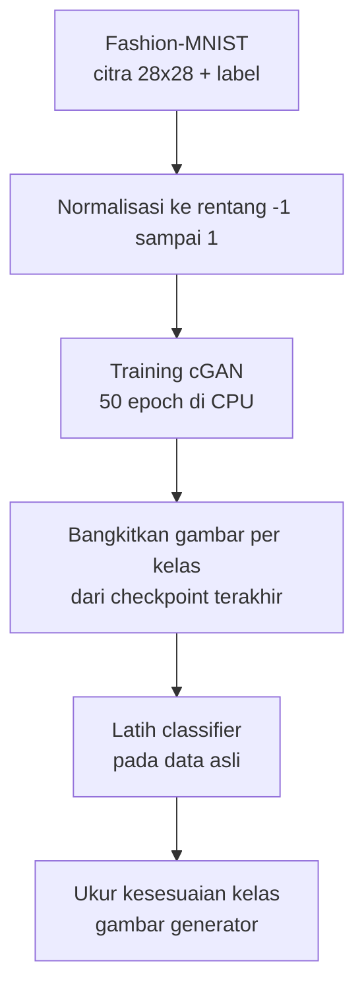
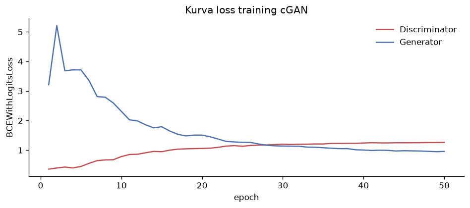
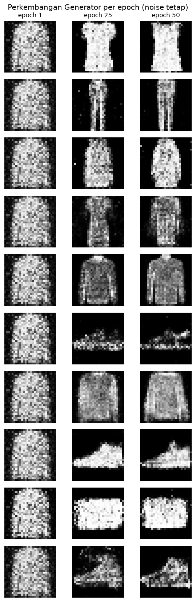
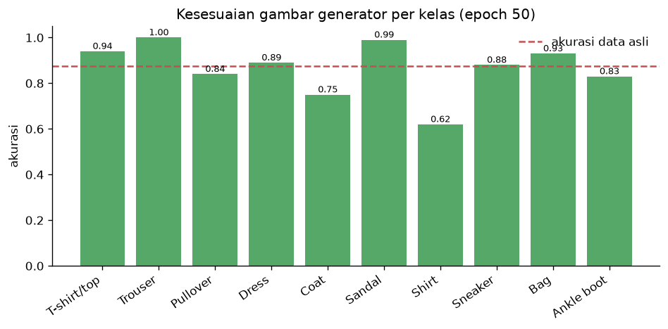
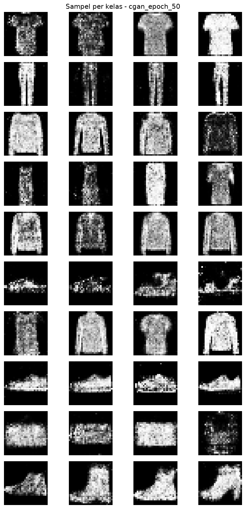
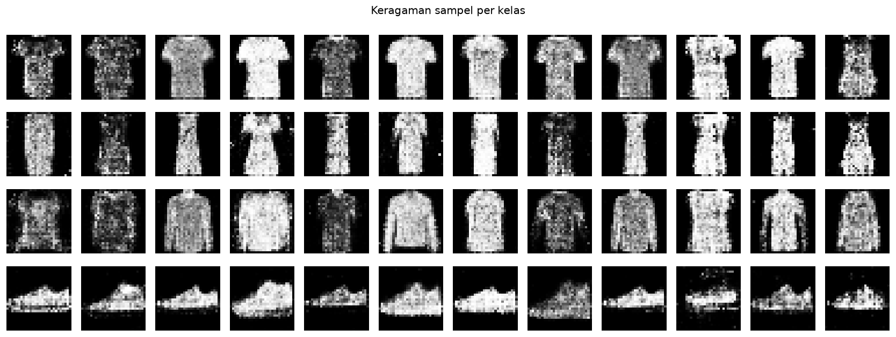

<!-- prettier-ignore -->
<div align="center">


# FashionCGAN

**Generasi Citra Pakaian Fashion-MNIST dengan Conditional GAN Berbasis MLP**

Laporan Tugas Mata Kuliah Generative AI · Kelas Generative AI · 2026

Program Studi Sarjana Informatika, Fakultas Informatika, Universitas Telkom

[Gambaran](#-gambaran) • [Teori](#-dasar-teori) • [Cara Kerja](#-cara-kerja) • [Hasil](#-hasil) • [Tim](#-tim--jobdesk) • [Menjalankan Ulang](#-menjalankan-ulang)

</div>

> [!NOTE]
> **Ringkasan satu paragraf.** Kami membangun *conditional* GAN dari nol — tanpa model *pretrained* dan tanpa library GAN, hanya PyTorch — untuk membangkitkan citra pakaian 28×28 piksel pada sepuluh kelas. Setelah 50 epoch di CPU, gambar buatan generator dikenali sesuai label yang diminta sebesar **86,70%**, hanya berselisih **0,85 poin** dari akurasi classifier yang sama pada data asli (**87,55%**).

---

## 📌 Gambaran

GAN biasa hanya bisa "membuat gambar pakaian", tapi tidak bisa diminta *jenis* pakaian apa. Kami menambahkan **label kelas** sebagai kondisi pada Generator dan Discriminator, sehingga model bisa menghasilkan kaus saat diminta kaus, dan sepatu saat diminta sepatu.

Karena itu, proyek ini mengejar tiga hal:

1. **Transparan** — setiap rumus (loss, conditioning, optimasi) ditulis tangan, bukan disembunyikan di balik pustaka siap pakai.
2. **Dapat diuji** — 36 pengujian otomatis memastikan kontrak data benar, termasuk bukti bahwa mengubah label benar-benar mengubah gambar.
3. **Terukur** — kualitas dinilai dengan angka, bukan hanya "kelihatan bagus", memakai classifier independen.

| Aspek | Nilai |
|---|---|
| Dataset | Fashion-MNIST (60.000 latih / 10.000 uji, 10 kelas) |
| Resolusi | 28×28 piksel grayscale |
| Arsitektur | cGAN berbasis MLP |
| Training | 50 epoch di CPU, ±17,7 menit |
| Hasil utama | Kesesuaian kelas **86,70%** vs data asli **87,55%** |
| Pengujian | 36 lulus (4,17 detik) |

---

## 📚 Dasar Teori

Bab ini menjelaskan *mengapa* model dirancang seperti ini. Rumusnya singkat, karena inti pekerjaan ada di [Cara Kerja](#-cara-kerja).

**GAN** melatih dua jaringan yang saling bersaing: Generator $G$ membuat gambar palsu, Discriminator $D$ menilai asli atau palsu.

$$
\min_{G}\max_{D} V(D,G) = \mathbb{E}_{x\sim p_{\text{data}}}[\log D(x)] + \mathbb{E}_{z\sim p_z}[\log(1-D(G(z)))]
$$

**Masalahnya:** GAN biasa tidak bisa dikendalikan. **cGAN** menambahkan kondisi $y$ (label kelas) ke kedua jaringan, sehingga kualitas dinilai tidak hanya dari "asli atau palsu", tetapi juga "sesuai label atau tidak".

$$
\mathbb{E}_{x,y}[\log D(x,y)] + \mathbb{E}_{z,y}[\log(1-D(G(z,y)))]
$$

**MLP** dipilih daripada CNN karena tujuannya pembelajaran: semua bobot dan aliran gradien bisa diperiksa langsung. Konsekuensinya, MLP tidak "melihat" bahwa piksel bertetangga saling berkaitan — inilah sumber utama kekaburan tepi pada hasil kami.

**Loss dan optimizer.** Kami memakai `BCEWithLogitsLoss` (gabungan sigmoid dan cross-entropy, stabil secara numerik) dengan Adam. Strategi standar GAN dipakai: Generator dilatih dengan tujuan non-*saturating* agar gradiennya tidak mati saat Discriminator sudah terlalu percaya diri.

> [!TIP]
> **Kenapa tidak pakai FID?** *Fréchet Inception Distance* butuh model *pretrained*. Karena proyek ini melarang model eksternal, kami memakai pendekatan dua tingkat: latih classifier dari data asli, lalu ukur berapa persen gambar generator yang diklasifikasikan sesuai labelnya. Metrik ini mengukur **kesesuaian kelas**, bukan keindahan visual.

---

## ⚙️ Cara Kerja



### Conditioning label

Inti seluruh proyek ada di satu trik sederhana: **label diubah menjadi vektor one-hot, lalu ditempel ke masukan.**

| Jaringan | Masukan | Ukuran | Keluaran |
|---|---|---:|---|
| Generator | noise (100) + one-hot label (10) | **110** | gambar 28×28 di rentang [−1, 1] |
| Discriminator | gambar diratakan (784) + one-hot label (10) | **794** | satu skor logit |

Karena label ikut masuk ke **Discriminator**, jaringan ini tidak bisa menipu dengan gambar yang bagus tapi salah kelas — gambar kaus tidak akan lolos saat diberi label "sepatu".

### Arsitektur

**Generator** — noise + label, lalu naik ke citra:

```
Concat (110) → Linear 256 + ReLU → Linear 512 + ReLU → Linear 784 + tanh → Reshape 1×28×28
```

**Discriminator** — citra + label, lalu turun ke satu angka:

```
Concat (794) → Linear 512 + LeakyReLU(0,2) → Linear 256 + LeakyReLU(0,2) → Linear 1 (logit)
```

Fungsi `tanh` di ujung Generator memastikan output berada di [−1, 1], persis sama dengan rentang data setelah normalisasi. Discriminator sengaja tidak memakai sigmoid karena `BCEWithLogitsLoss` sudah menanganinya — memasang sigmoid ganda akan membuat training tidak stabil.

### Satu langkah training

Setiap batch memperbarui Discriminator lebih dulu, baru Generator — dengan parameter Discriminator dibekukan sementara agar Generator tidak "menggeser gawangnya sendiri".

```python
z  = noise(batch)
fake = G(z, y)                              # gambar palsu

# 1. Discriminator: asli = 1, palsu = 0
loss_D = BCE(D(x, y), 1) + BCE(D(fake.detach(), y), 0)
loss_D.backward(); opt_D.step()

# 2. Generator: minta Discriminator percaya gambar palsunya "asli"
loss_G = BCE(D(fake, y), 1)
loss_G.backward(); opt_G.step()
```

### Konfigurasi

Semua pengaturan tersimpan di [`configs/default.yaml`](../configs/default.yaml) agar setiap run dapat direproduksi.

| Parameter | Nilai |
|---|---|
| Seed | 42 (Python, NumPy, PyTorch, urutan *shuffle*) |
| Batch size | 128 |
| Epoch | 50 |
| Optimizer | Adam, lr 2×10⁻⁴, β = (0,5; 0,999) |
| Loss | `BCEWithLogitsLoss` |
| Dimensi noise | 100 |

---

## 📊 Hasil

### Training berjalan stabil

| Epoch | Loss D | Loss G |
|---:|---:|---:|
| 1 | 0,3578 | 3,2119 |
| 25 | 1,1315 | 1,2639 |
| 50 | **1,2613** | **0,9564** |

Kedua kurva bertemu dan berosilasi di sekitar 1 pada paruh kedua — tanda permainan D dan G seimbang, tidak ada pihak yang mendominasi.



**Perkembangan seiring epoch.** Dengan noise yang sama, gambar berubah dari gumpalan abu-abu tanpa bentuk (epoch 1) menjadi siluet yang jelas (epoch 50).



> [!IMPORTANT]
> **Loss kecil ≠ gambar bagus.** Nilai loss GAN bersifat relatif terhadap kekuatan lawan. Perhatikan loss D yang justru *naik* dari epoch 25 ke 50, padahal bentuk gambarnya membaik. Karena itu kami menilai kualitas dengan angka terpisah di bawah.

### Kesesuaian kelas per kelas

Classifier dilatih dari data asli (akurasi **0,8755**), lalu diminta menebak 100 gambar generator per kelas.

| Kelas | Akurasi | Catatan |
|---|---:|---|
| Trouser | **1,00** | siluet paling khas |
| Sandal | 0,99 | siluet khas |
| T-shirt/top | 0,94 | tinggi |
| Bag | 0,93 | tinggi |
| Dress | 0,89 | sedang |
| Sneaker | 0,88 | sedang |
| Pullover | 0,84 | beririsan dengan Coat/Shirt |
| Ankle boot | 0,83 | sedang |
| Coat | 0,75 | rendah — mirip Pullover |
| Shirt | **0,62** | terendah — mirip T-shirt/Coat |

**Rata-rata generator 0,8670** vs **data asli 0,8755**.



### Contoh hasil

Empat sampel per kelas dari checkpoint terakhir — perhatikan kelas berarsitektur khas (Trouser, Bag, Sneaker) jauh lebih tegas daripada kelompok atasan (Shirt, Pullover, Coat).



**Satu noise, sepuluh label.** Semua kotak di bawah berasal dari vektor noise yang *sama*; hanya labelnya yang berbeda. Perbedaan bentuk membuktikan conditioning bekerja.


**Cek mode collapse** — apakah generator hanya menghasilkan satu variasi? Tidak: variasi lengan dan sol sepatu masih terlihat.



### Interpretasi

| Temuan | Arti |
|---|---|
| Selisih hanya 0,85 poin dari data asli | Mayoritas gambar generator sudah "terbaca" sebagai kelas yang diminta |
| Kelas bersiluet unik skor tinggi | Model berhasil menangkap bentuk global |
| Kelas atasan skor rendah | MLP kesulitan membedakan kerah dan panjang lengan — detail halus |
| Loss tidak sejalan kualitas | Metrik evaluasi terpisah memang diperlukan |

> [!WARNING]
> Angka 86,70% **bukan** klaim bahwa gambar setara data asli. Classifier yang dipakai kecil dan dilatih singkat, sehingga belum tentu menangkap cacat tekstur yang terlihat mata manusia. Angka ini mengukur kesesuaian kelas, bukan estetika.

---

## 👥 Tim & Jobdesk

| Anggota | NIM | Peran | Kontribusi utama |
|---|---|---|---|
| **Ivander Dzaky Khairullah** | 103012300174 | Arsitek model & *Prompt Engineer* | `models.py`, `tests/test_models.py`, `architecture.md` |
| **Muhammad Ragil** | 103012300015 | Data pipeline & training | `data.py`, `train.py`, `configs/default.yaml`, pengujian data/training |
| **Silmi Sila Nia Uma** | 103012430070 | Dokumentasi & evaluasi | `evaluate.py`, `utils.py`, `docs/`, notebook laporan |

Dosen Pengampu: **Dr. Aditya Firman Ihsan, S.Si., M.Si.**

Bukti sesi pemakaian asisten AI tersimpan per anggota di [`evidence/`](../evidence) (contoh: `session-002-generator-discriminator.md`) beserta ekspor JSON aslinya.

---

## 🔧 Menjalankan Ulang

> [!NOTE]
> Diasumsikan Python 3.10+ dan virtual environment `.venv` sudah aktif, dengan `pip install -r requirements.txt` sudah dijalankan. Di Windows PowerShell, `PYTHONPATH` harus diisi `src` agar paket `fashion_cgan` dapat diimpor.

```bash
# 1. Pastikan semuanya sehat (36 tes, ±4 detik)
python -m pytest tests -q

# 2. Latih dari awal (50 epoch, ±18 menit di CPU)
python -m fashion_cgan.train --device cpu

# 3. Bangkitkan grid gambar dari checkpoint terakhir
python -m fashion_cgan.generate outputs/cgan_epoch_50.pt

# 4. Ukur kesesuaian kelas
python -m fashion_cgan.evaluate outputs/cgan_epoch_50.pt

# 5. Buat ulang gambar laporan
#    (jalankan notebooks/report_visuals.ipynb dari root repositori)
```

Training bisa dilanjutkan bila terputus: `python -m fashion_cgan.train --resume outputs/cgan_epoch_N.pt`

### Struktur repositori

```
fashion_cgan/
├── src/fashion_cgan/
│   ├── models.py      Generator + Discriminator (dengan validasi masukan)
│   ├── data.py        Loader Fashion-MNIST, normalisasi [-1, 1]
│   ├── train.py       Loop training, checkpoint, metrik
│   ├── generate.py    Grid gambar dari checkpoint
│   ├── evaluate.py    Classifier + akurasi per kelas
│   └── utils.py       Denormalisasi, simpan grid
├── configs/default.yaml
├── tests/             36 pengujian
├── notebooks/         Visualisasi laporan
├── docs/              Arsitektur, rencana, evaluasi
└── evidence/          Bukti sesi per anggota
```

---

## 🧭 Refleksi

**Yang berhasil.** Conditioning label terbukti bekerja secara terukur, bukan sekadar "kelihatannya beda". Pipeline reproducible dan seluruh klaim didukung angka yang bisa dijalankan ulang — tanpa satu pun model eksternal.

**Yang belum.** MLP tidak memanfaatkan kedekatan spasial antarpiksel, sehingga tepi dan tekstur pakaian masih kabur, terutama pada kelompok atasan. Keragaman baru diperiksa secara visual, belum dihitung.

**Langkah berikutnya.**

- Tambahkan lapisan konvolusional (DCGAN) sebagai eksperimen terpisah, tanpa mengubah kontrak data.
- Tambahkan metrik keragaman yang tetap tidak butuh model eksternal.
- Perbesar kapasitas classifier evaluasi agar lebih sensitif terhadap cacat lokal.

---

## 📖 Referensi

1. I. Goodfellow, J. Pouget-Abadie, M. Mirza, B. Xu, D. Warde-Farley, S. Ozair, A. Courville, Y. Bengio. *Generative Adversarial Nets.* NeurIPS, 2014.
2. M. Mirza, S. Osindero. *Conditional Generative Adversarial Nets.* arXiv:1411.1784, 2014.
3. H. Xiao, K. Rasul, R. Vollgraf. *Fashion-MNIST: a Novel Image Dataset for Benchmarking Machine Learning Algorithms.* arXiv:1708.07747, 2017.
4. I. Goodfellow, Y. Bengio, A. Courville. *Deep Learning.* MIT Press, 2016.
5. D. P. Kingma, J. Ba. *Adam: A Method for Stochastic Optimization.* ICLR, 2015.
6. M. Heusel, H. Ramsauer, T. Unterthiner, B. Nessler, S. Hochreiter. *GANs Trained by a Two Time-Scale Update Rule Converge to a Local Nash Equilibrium.* NeurIPS, 2017.
7. T. Salimans, I. Goodfellow, W. Zaremba, V. Cheung, A. Radford, X. Chen. *Improved Techniques for Training GANs.* arXiv:1606.03498, 2016.
8. S. Ioffe, C. Szegedy. *Batch Normalization: Accelerating Deep Network Training by Reducing Internal Covariate Shift.* ICML, 2015.
9. A. Radford, L. Metz, S. Chintala. *Unsupervised Representation Learning with Deep Convolutional Generative Adversarial Networks.* arXiv:1511.06434, 2015.
10. A. Paszke dkk. *PyTorch: An Imperative Style, High-Performance Deep Learning Library.* NeurIPS, 2019.

---

<sub>Versi LaTeX lengkap (PDF, cover resmi, daftar gambar/tabel) tersedia di [`main.tex`](main.tex) dan `Laporan-*.pdf` pada folder ini.</sub>
